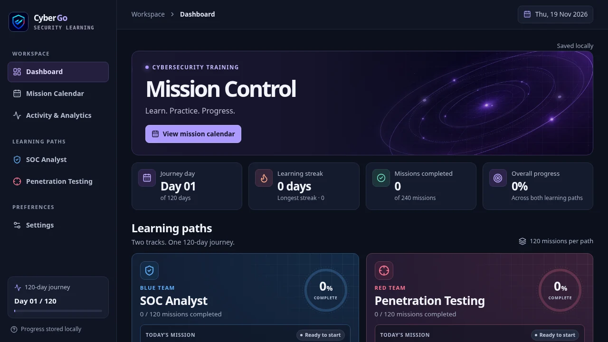
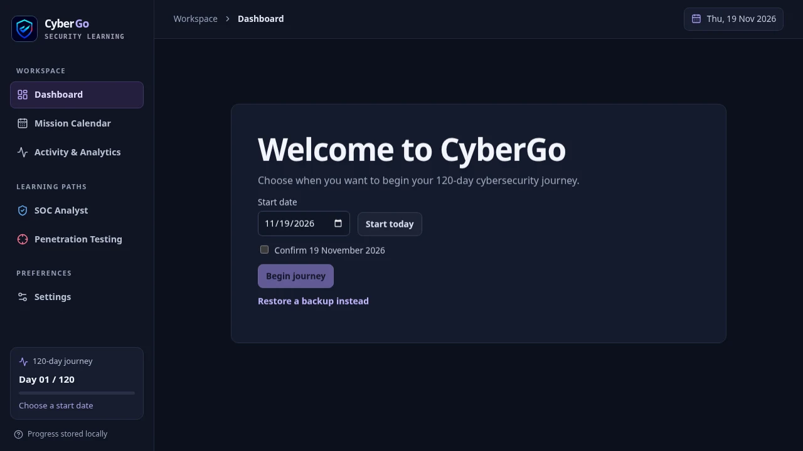

# CyberGo

**Learn. Practice. Progress.**

CyberGo is a free, offline desktop companion for cybersecurity students on Windows and macOS. It brings the original CyberMission 120 dashboard and its 240 practical missions to a local application.

- **SOC Analyst** covers telemetry, networking, SIEM, detection engineering, triage, and reporting.
- **Penetration Testing** covers lab scope, local assessment, evidence review, secure configuration, and reporting.
- Both tracks run for 120 days from your selected start date. Each has independent checklists, notes, completions, and study time.
- The dashboard shows actual activity, calendar history, and streaks. Past missions stay available for review and completion.





## Install

Use the Windows x64 installer or the macOS disk image matching your processor. ZIP wrappers include the same native package and a short installation guide. When a release is published, use the repository’s **Releases** tab for downloads and checksums. See the [installation guide](docs/Installation_Guide.md) for requirements, publisher notices, and package names.

## Progress and backups

CyberGo starts without an account. Choose and confirm the date you want to begin, then open either learning path. Mark a mission complete after satisfying its checklist. CyberGo saves local notes and records to SQLite and stores evidence separately in the per-user application data folder.

Use **Settings → Export my data** for a portable ZIP of progress, settings, and evidence. To move to another computer, select the ZIP in **Import my data**, review its summary, and confirm replacement. Export JSON from CyberMission 120 and choose **Import browser JSON** to migrate earlier progress. Download older browser evidence files individually, then reattach them to their missions in CyberGo.

## Development

Install Node.js 22 or later, Python 3, Rust stable, and [Tauri system prerequisites](https://v2.tauri.app/start/prerequisites/).

```sh
npm ci
npm run typecheck
npm run lint
npm run validate
npm test
cargo test --manifest-path src-tauri/Cargo.toml --locked --no-default-features
npm run build
npx playwright install chromium
npm run test:browser
npm run desktop -- dev
```

Use `npm run desktop -- build --bundles nsis` on Windows or `npm run desktop -- build --bundles dmg` on macOS. The static `out/` export is embedded in the application. Normal use requires no server or development tools.

See the [architecture](docs/Architecture.md), [testing report](docs/Testing_Report.md), [development report](docs/CyberGo_Development_Report.md), and [contribution guide](CONTRIBUTING.md).

## Security and licensing

Run mission exercises manually in your own authorized lab. CyberGo stores evidence locally and opens it in external apps only when you ask. Backups contain your notes and files, so keep them somewhere private. CyberGo’s source and original assets are available under the [MIT License](LICENSE). Dependencies and optional lab tools retain their own licenses and are maintained separately.
