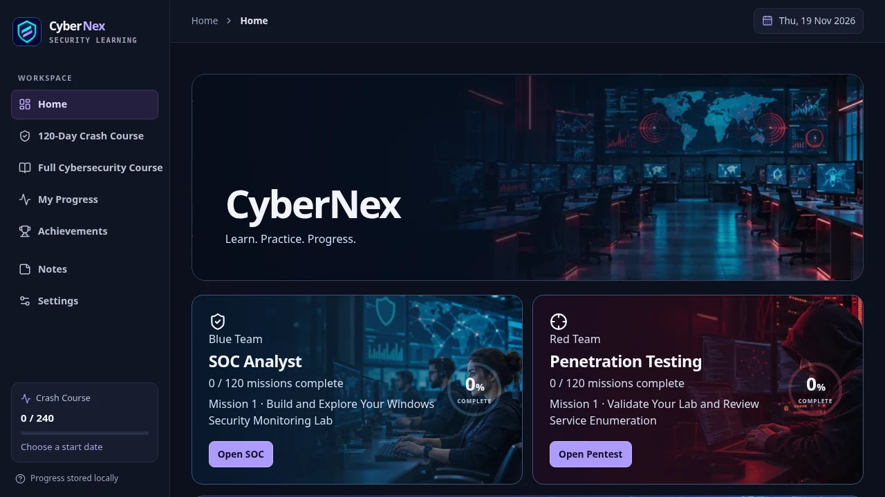
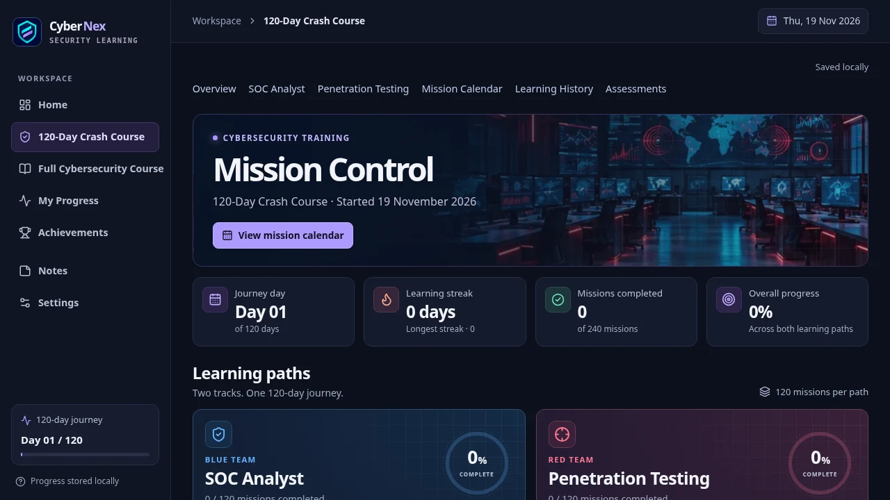
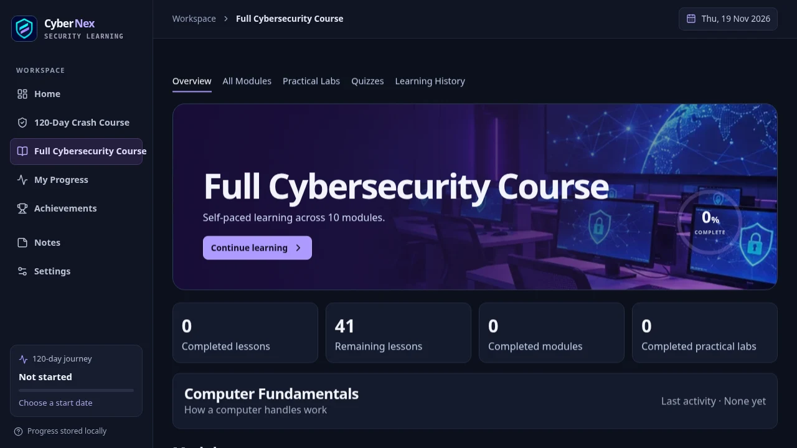
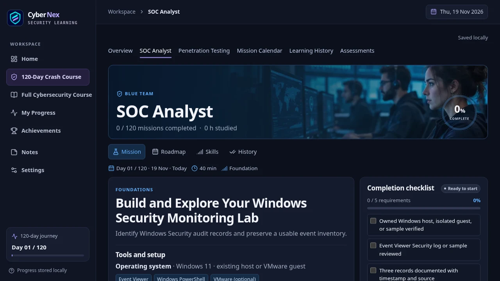
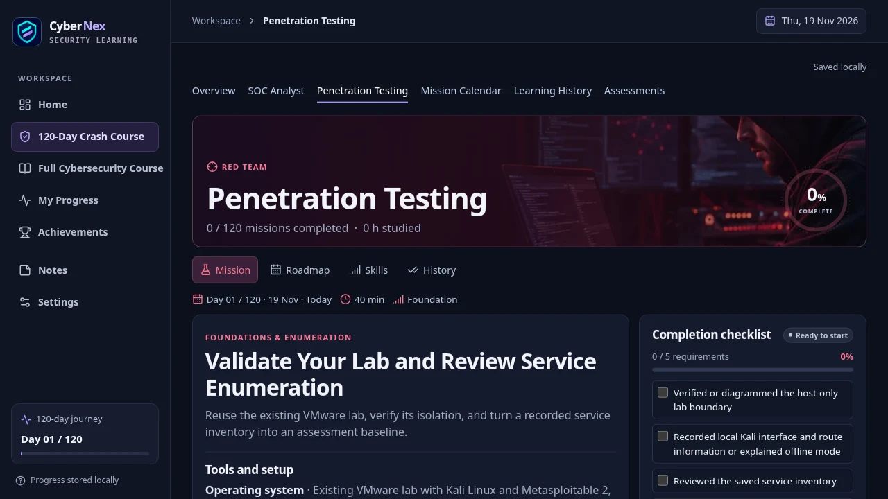
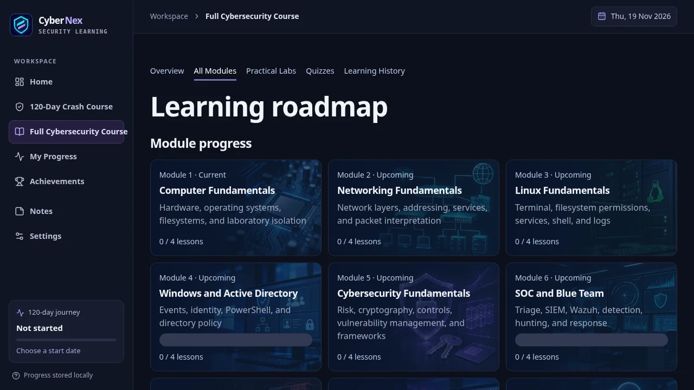

# CyberNex

**Learn. Practice. Progress.**

CyberNex is a free cybersecurity learning app for Windows and macOS. It packages the curriculum, exercises, illustrations, quizzes, and progress tracking for offline study.



## Two ways to learn

| Mode | What you can do |
| --- | --- |
| **120-Day Crash Course** | Set a start date and follow 120 SOC Analyst missions and 120 Penetration Testing missions, each with its own checklist, evidence, and notes. Review older missions at any time. |
| **Full Cybersecurity Course** | Study 41 lessons across 10 modules at your own pace. Continue Learning opens the next incomplete lesson. Pick a priority module from the roadmap to change your sequence. |

Take knowledge checks, work through practical assessments, and track learning activity, module progress, skill areas, and achievements. Practice assessment methods using written scope, sanitized records, and defensive review in your authorized learning environment.

## Screenshots

| Crash Course | Full Course |
| --- | --- |
|  |  |
|  |  |
|  |  |

## Install

| Platform | Native installer | ZIP with guide |
| --- | --- | --- |
| Windows x64 | [Setup EXE](https://github.com/veerendranadhreddy11/CyberGo/releases/download/v2.0.0/CyberNex-Setup-Windows-x64.exe) | [ZIP](https://github.com/veerendranadhreddy11/CyberGo/releases/download/v2.0.0/CyberNex-v2.0.0-Windows-x64.zip) |
| macOS Apple Silicon | [DMG](https://github.com/veerendranadhreddy11/CyberGo/releases/download/v2.0.0/CyberNex-macOS-AppleSilicon.dmg) | [ZIP](https://github.com/veerendranadhreddy11/CyberGo/releases/download/v2.0.0/CyberNex-v2.0.0-macOS-AppleSilicon.zip) |
| macOS Intel | [DMG](https://github.com/veerendranadhreddy11/CyberGo/releases/download/v2.0.0/CyberNex-macOS-Intel.dmg) | [ZIP](https://github.com/veerendranadhreddy11/CyberGo/releases/download/v2.0.0/CyberNex-v2.0.0-macOS-Intel.zip) |

[CyberNex v2.0.0 release](https://github.com/veerendranadhreddy11/CyberGo/releases/tag/v2.0.0) · [SHA-256 checksums](https://github.com/veerendranadhreddy11/CyberGo/releases/download/v2.0.0/SHA256SUMS.txt)

The targets are Windows 10 or 11 x64 and macOS 11 or later. See the [installation guide](docs/Installation_Guide.md) for signing and upgrade details.

## Progress and backups

Learning progress stays on the student's own computer and does not automatically synchronize between devices. Open **Settings → Export my data** for a ZIP containing both modes, quiz attempts, achievements, preferences, and evidence. Confirm replacement after reviewing the summary in **Import my data**. CyberGo users can upgrade in place. CyberNex uses the existing application data directory and can import older CyberGo ZIPs.

## Development

Install Node.js 22 or later, stable Rust, Python 3, and the [Tauri system prerequisites](https://v2.tauri.app/start/prerequisites/).

```sh
npm ci
npm run lint
npm run typecheck
npm run validate
npm test
cargo test --manifest-path src-tauri/Cargo.toml --locked --no-default-features
npm run build
npx playwright install chromium
npm run test:browser
npm run desktop -- dev
```

Read the [architecture](docs/Architecture.md), [curriculum](docs/Full_Course_Curriculum.md), [testing report](docs/Testing_Report.md), [development report](docs/CyberNex_Development_Report.md), and [contribution guide](CONTRIBUTING.md). CyberNex uses the [MIT License](LICENSE).
